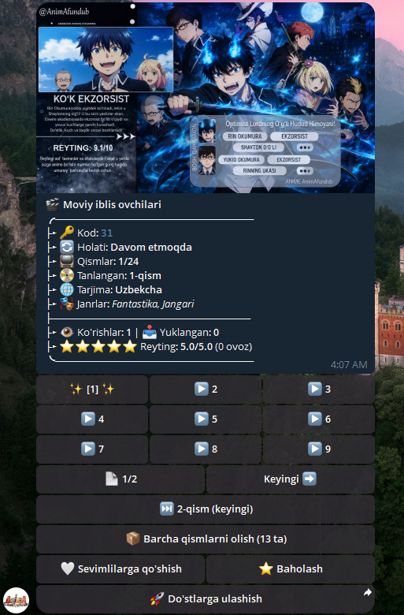
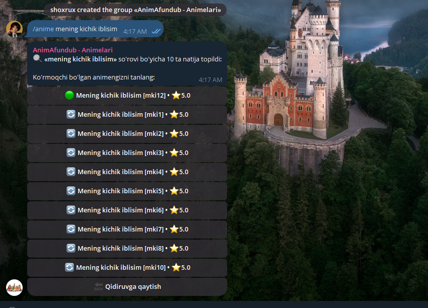
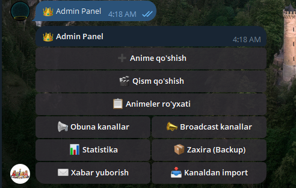

# 🎬 AnimaFundub — Telegram Anime Bot

Zamonaviy, tezkor va ko'p funksiyali Telegram anime boti. Foydalanuvchilar qisqa raqamli kodlar, nomlar yoki janrlar bo'yicha anime qidirishi, qismlarni tanlab tomosha qilishi hamda guruhlarda bevosita botdan foydalanishi mumkin. Bot **Python 3.10+**, **aiogram 3.13** va asinxron **SQLite (aiosqlite)** asosida qurilgan.

---

## 📸 Skrinshotlar / Screenshots

<p align="center">
  
  &nbsp;&nbsp;&nbsp;&nbsp;
  
  &nbsp;&nbsp;&nbsp;&nbsp;
  
</p>

<p align="center">
  <b>1. Anime kartasi & Qismlar</b> &nbsp;&nbsp;|&nbsp;&nbsp; <b>2. Guruhda qidirish</b> &nbsp;&nbsp;|&nbsp;&nbsp; <b>3. Admin boshqaruv paneli</b>
</p>

---

## ✨ Imkoniyatlar (Features)

### 👤 Foydalanuvchilar uchun:
- **🔑 Kod bo'yicha tomosha qilish** — Animenung qisqa kodini (masalan: `31`) yuborish orqali to'liq ma'lumot va videoni bir zumda olish.
- **🔗 Deep Links** — `/start <code>` havolasi orqali to'g'ridan-to'g'ri kerakli animega o'tish (do'stlarga ulashish uchun juda qulay).
- **📺 Ko'p qismli (Multi-Episode) tizim** — Har bir qism uchun qulay tugmalar tarmog'i (1, 2, 3...), qismlar paginatsiyasi, keyingi qismga tezkor o'tish va barcha qismlarni birdaniga olish tugmasi.
- **🛡 Kontent himoyasi (Anti-Share / Protect Content)** — Bot tomonidan yuborilgan videolarni boshqa chatlarga uzatish (forward), qurilmaga yuklab olish (download) va skrinshot olish bloklangan.
- **👥 Guruhlarga to'liq moslashuvchanlik (Group Mode)**:
  - Guruhlarda `/anime <nomi>`, `/kod <raqam>` buyruqlari.
  - Bot foydalanuvchi nomini teg qilish orqali qidirish (`@bot_username Naruto`).
  - Bot xabarlariga reply qilib qidirish.
  - Guruh chatini ortiqcha menyular bilan to'ldirmasdan toza va qulay javob qaytarish.
- **🔍 Qidiruv va tavsiyalar**:
  - Nomi yoki kalit so'zlar bo'yicha qidiruv.
  - 🎭 **Janrlar bo'yicha saralash** (Fantastika, Jangari, Romantika va h.k.).
  - 🔥 **Top Animelar** — Ko'rishlar va reyting bo'yicha eng ommabop animelar ro'yxati.
  - 🎲 **Random Anime** — Tasodifiy anime tavsiya qilish.
  - ⚡ **Inline qidiruv** — Istalgan chatda `@bot_username anime_nomi` deb qidirish.
- **⭐ Reyting va statistika**:
  - Foydalanuvchilar tomonidan 1 dan 5 gacha baholash tizimi.
  - Har bir animeda ko'rishlar (👁) va yuklab olishlar (📥) sonini ko'rsatish.
- **🗂 Shaxsiy kabinet**:
  - ❤️ **Sevimlilar (Favorites)** — Yoqqan animelarni saqlab qo'yish.
  - 🕒 **Ko'rishlar tarixi (History)** — Avval ochilgan animelar ro'yxati.
- **🔒 Majburiy obuna (Forced Subscription)** — Kanallarga a'zo bo'lmaguncha botdan foydalanishni cheklovchi xavfsiz middleware va tekshirish tizimi.

---

### 👑 Adminlar uchun (`/panel`):
- **🔐 Xavfsiz kirish** — Parol bilan himoyalangan admin tizimi va bazaga yangi adminlarni biriktirish.
- **➕ Animelar va Qismlar boshqaruvi**:
  - Yangi animelarni bosqichma-bosqich (FSM) qo'shish va tahrirlash.
  - Har bir anime uchun alohida yangi qismlarni (video yoki post ID) yuklash.
  - Ro'yxatdan anime qidirish va o'chirish.
- **📊 To'liq statistika** — Jami foydalanuvchilar, so'nggi 24 soat va 7 kundagi faol userlar, umumiy animelar, ko'rishlar va yuklashlar statistikasi.
- **✉️ Xabar tarqatish (Broadcast)** — Botning barcha a'zolariga rasm, video va matnli xabarlarni xavfsiz tezlikda tarqatish.
- **📢 Majburiy obuna kanallari** — Botga ulanadigan obuna kanallarini admin panel orqali qo'shish va olib tashlash.
- **📣 Kanalga avtomatik e'lon (Broadcast Channels)** — Yangi anime qo'shilganda belgilangan kanallarga chiroyli post qilib chiqarish.
- **📥 Kanaldan import** — Yopiq kanaldan postlarni ommaviy import qilish imkoniyati.
- **📦 Avtomatik zaxira nusxasi (Auto Backup)** — Har kuni belgilangan vaqtda SQLite ma'lumotlar bazasini bosh adminga yuboruvchi avtomatik scheduler.

---

## 🛠 Texnologiyalar (Tech Stack)

| Qatlam | Texnologiya | Tavsif |
|---|---|---|
| **Dasturlash tili** | Python 3.10+ | Asinxron imkoniyatlar |
| **Bot Framework** | [aiogram 3.13](https://docs.aiogram.dev/) | Routerlar, filtrlash va middleware arxitekturasi |
| **Ma'lumotlar bazasi**| SQLite via [aiosqlite](https://github.com/omnilib/aiosqlite) | Yengil, tezkor va asinxron relational DB |
| **State Management** | aiogram MemoryStorage | FSM (Finite State Machine) holatlari |
| **Konfiguratsiya** | `python-dotenv` | Muhit o'zgaruvchilari (`.env`) |

---

## 🧠 Qanday ishlaydi? (Arxitektura)

Videolar ma'lumotlar bazasida **saqlanmaydi** — faqat ularning koordinatalari saqlanadi. Har bir anime qismi xususiy **saqlash kanali**dagi (`SOURCE_CHANNEL_ID`) xabar ID raqamiga (`source_message_id`) yoki Telegram `file_id` ga bog'lanadi:

```
[ Foydalanuvchi / Guruh ]
          │
          ▼
   [ Anime Bot ]
          │  1. Anime kartasi & qismlar menyusi yuboriladi
          │  2. bot.copy_message / bot.send_video (protect_content=True)
          ▼
[ Xususiy Saqlash Kanali ] ────► Video to'g'ridan-to'g'ri foydalanuvchiga yetkaziladi
```

Bu yondashuv ma'lumotlar bazasini juda ixcham saqlaydi va fayllarni qayta yuklash zaruratini yo'q qiladi. Shuningdek, `protect_content=True` orqali mualliflik huquqi va kanalingiz kontenti himoyalangan bo'ladi.

---

## 📁 Loyiha tuzilishi (Project Structure)

```text
animebot/
├── bot.py                  # Asosiy kirish nuqtasi: Dispatcher, middleware va scheduler
├── config.py               # .env ma'lumotlarini yuklash
├── requirements.txt        # Kerakli kutubxonalar ro'yxati
├── anime_bot.db            # SQLite ma'lumotlar bazasi (avtomatik yaratiladi)
├── docs/
│   └── images/             # README uchun skrinshotlar
├── database/
│   └── db.py               # Barcha SQL so'rovlar (users, animes, episodes, ratings, channels)
├── handlers/
│   ├── start.py            # /start, deep linklar va asosiy menyu
│   ├── anime.py            # Kod bo'yicha qidirish, qismlar boshqaruvi, reyting, guruh qidiruvi
│   ├── cabinet.py          # Foydalanuvchi kabineti (Sevimlilar va Tarix)
│   ├── admin.py            # Admin panel (CRUD, statistika, kanallar, xabar yuborish)
│   ├── subscription.py     # Majburiy obuna tekshiruvi
│   └── channel.py          # Saqlash kanalidan avtomatik aniqlash
├── keyboards/
│   └── main.py             # Barcha inline va reply tugmalar (qismlar jadvali, menyular)
├── middlewares/
│   ├── subscription.py     # Kanallarga obuna bo'lmaganlarni to'xtatuvchi middleware
│   ├── chat_type.py        # Guruh va shaxsiy chat xabarlarini moslashtiruvchi middleware
│   └── activity.py         # Foydalanuvchi faolligini qayd etuvchi middleware
└── utils/
    ├── backup.py           # Kunlik avtomatik bazani zaxiralash
    └── broadcaster.py      # Xabarlarni tezkor va xavfsiz tarqatish yordamchisi
```

---

## 🚀 O'rnatish va Ishga tushirish (Installation)

### Talablar:
- Python 3.10 yoki undan yuqori
- [@BotFather](https://t.me/BotFather) orqali olingan Telegram Bot tokeni
- Videolarni saqlash uchun yopiq kanal (bot ushbu kanalda **Admin** bo'lishi shart)

### Qadamlar:

```bash
# 1. Repozitoriyani klon qiling
git clone https://github.com/Shibuya-qa/AnimA-bot.git
cd AnimA-bot

# 2. Virtual muhit yaratish va faollashtirish
python -m venv venv
# Windows:
venv\Scripts\activate
# Linux / macOS:
source venv/bin/activate

# 3. Kerakli paketlarni o'rnatish
pip install -r requirements.txt

# 4. Muhit o'zgaruvchilarini sozlash
cp .env.example .env
```

`.env` faylini ochib, o'z ma'lumotlaringizni kiriting:

```env
BOT_TOKEN=1234567890:AAExampleTokenHere
ADMIN_IDS=123456789,987654321
ADMIN_PASSWORD=sizning_maxfiy_parolingiz
SOURCE_CHANNEL_ID=-1001234567890
```

### Botni ishga tushirish:
```bash
python bot.py
```

---

## ⚙️ Sozlamalar jadvali (`.env`)

| O'zgaruvchi | Tavsif | Misol |
|---|---|---|
| `BOT_TOKEN` | Telegram bot tokeni | `7123456789:AAF...` |
| `ADMIN_IDS` | Asosiy adminlarning Telegram ID raqamlari (vergul bilan) | `123456789` |
| `ADMIN_PASSWORD` | `/panel` ga kirish uchun boshlang'ich parol | `admin123` |
| `SOURCE_CHANNEL_ID` | Videolar saqlanadigan kanal ID'si | `-1001987654321` |

---

## 📝 Muallif va Litsenziya

Loyiha anime ixlosmandlari va jamoalari uchun qulay, xavfsiz va tezkor platforma taqdim etish maqsadida ishlab chiqilgan.
Taklif va savollar bo'yicha GitHub issues orqali bog'lanishingiz mumkin.
